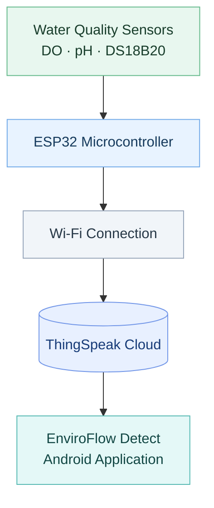

<div align="center">

# EnviroFlow Detect

### IoT-Based River Water Quality Monitoring System

Monitoring dissolved oxygen, pH, and water temperature through IoT technology.


</div>

---

## 01. Overview

EnviroFlow Detect is an Android mobile application developed to monitor river water quality using three parameters: dissolved oxygen (DO), pH, and water temperature.

The system uses sensors connected to an ESP32 microcontroller to collect measurements and transmit the data through Wi-Fi to ThingSpeak. The mobile application retrieves the stored readings using a configured ThingSpeak Channel ID and presents them through monitoring tools and historical graphs.

## 02. System Architecture

The system follows a sensor-to-cloud-to-mobile architecture.



### How It Works

1. **Sensors** measure dissolved oxygen, pH, and water temperature.
2. **ESP32** processes the sensor readings and transmits the data.
3. **Wi-Fi** connects the hardware system to the internet.
4. **ThingSpeak Cloud** stores the transmitted sensor data.
5. **Android Application** retrieves the available readings using the ThingSpeak Channel ID and displays the results.

## 03. Hardware Components

| Component | Purpose |
|---|---|
| ESP32 Microcontroller | Processes readings and provides Wi-Fi connectivity |
| DFRobot Gravity Dissolved Oxygen Sensor | Measures dissolved oxygen in water |
| DFRobot Analog pH Sensor Pro Kit V2 | Measures water pH |
| DS18B20 Temperature Sensor | Measures water temperature |
| Power Supply | Powers the hardware system |

## 04. Technologies Used

| Technology | Description |
|---|---|
| Kotlin | Android application development |
| Android Studio | Application development environment |
| ThingSpeak | Cloud platform for storing and retrieving sensor data |
| ESP32 | Microcontroller for sensor data collection and transmission |
| Wi-Fi | Communication between the hardware and cloud platform |

## 05. Application Features

| Feature | Description |
|---|---|
| Dashboard | Displays current readings, alerts, and device status |
| Monitoring | Shows the latest available DO, pH, and temperature readings |
| History | Displays historical graphs and the 25 most recent readings |
| CSV Export | Exports recent readings and available historical data |
| Settings | Configures the ThingSpeak Channel ID |

## 06. Requirements

Before running the application, prepare the following:

- Android Studio
- EnviroFlow Detect project source code
- An Android device or emulator
- An active internet connection
- A valid ThingSpeak Channel ID containing the sensor data

## 07. Getting Started

### Step 1 — Clone the Repository

```bash
git clone <repository-url>
```

Replace `<repository-url>` with the URL of this GitHub repository.

Alternatively, download the repository as a ZIP file and extract it.

### Step 2 — Open the Project

1. Launch Android Studio.
2. Select **Open** and choose the project folder.
3. Allow Gradle to synchronize the project and download required dependencies.

### Step 3 — Configure ThingSpeak

1. Run the application on your Android device or emulator.
2. Navigate to **Settings**.
3. Enter the ThingSpeak Channel ID associated with your sensor data.
4. Save the configuration.

### Step 4 — Run the Application

Select **Run** in Android Studio and choose your connected Android device or emulator.

Ensure that the configured ThingSpeak channel contains the expected sensor data and that the device has internet access.

## 08. Important Notes

- An internet connection is required to retrieve cloud-based readings.
- The ThingSpeak Channel ID must correspond to the channel containing the sensor data.
- Sensor accuracy depends on proper installation, placement, and calibration.
- Protect the ESP32 and other electronic components from direct contact with water.

## 09. Project Information

| Detail | Information |
|---|---|
| Project Name | EnviroFlow Detect |
| Project Type | IoT Mobile Application |
| Monitoring Parameters | Dissolved Oxygen, pH, and Water Temperature |
| Version | 1.0 |
| Documentation Date | November 2025 |

---

<div align="center">

**EnviroFlow Detect**

*Monitoring Today for a Cleaner Tomorrow.*

</div>
